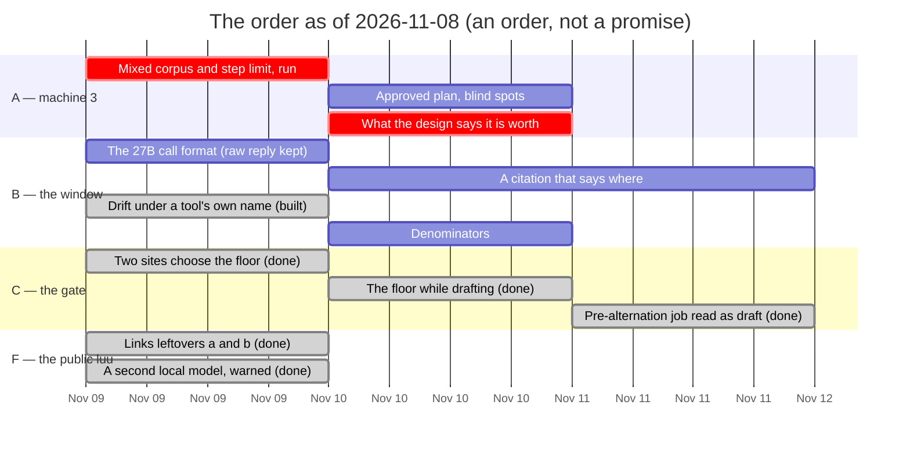

# Roadmap — revision 2026-11-08

**What this is:** the order of work as of this date, and what blocks what. It
is not a decision and not a description of the tree. For *what is true today*,
read [`luu-design.md`](../../luu-design.md). For *why*, read the dated file in
[`RECORD/`](../../RECORD/) that each item links to.

This revision supersedes [`ROADMAP/2026-09-23`](../2026-09-23/) wholesale, after
six and a half weeks. That revision grew five sections in place (E to I, rows
46 to 72) and struck what landed as it went, so most of this one is a harvest
of its strikes.

**Closed in it:**

- Rows 56, 57, 58, 59, 64, 65, 66, 67, 68, 69 and 70: users, the code by
  email, roles, passkeys, the image's isolation, links over SSH, and the
  release that publishes the images. Where one left something owed, the
  leftover is now row 71 or 74.
- Row 60, superseded by 65.
- Row 61, decided: a remote server keeps its own configuration.
- Row 14, **concurrency**. This one was never struck there. Steps 1–4 of
  [`sessions-side-by-side`](../../RECORD/2026-10-30.sessions-side-by-side.completed.md)
  built several live sessions, each with its own worker and folder, on
  2026-10-30, and the row sat in Section D still saying *needs a design
  argument*. It is struck there now, in place.
- Row 38's *building*, in the commit that cut this revision:
  [`a-corpus-that-overflows-with-mixed-output`](../../RECORD/2026-11-08.a-corpus-that-overflows-with-mixed-output.completed.md).
  Its *run* is carried.

Narrowed and carried: 49, 50, 51 and 55. Carried, some with a line added: 1,
3, 4, 7, 12, 13, 16, 21, 28, 29, 30, 35, 36, 37, 39 to 48, 52, 53, 54, 62, 63,
71 and 72. New rows continue from 73.

**Numbers are carried, not reassigned.** [`luu-design.md`](../../luu-design.md)
names item 12 by number, and a number that moves between revisions is a link
that lies.

## Picking up, as of the end of 2026-11-09

Built on `claude/admiring-sagan-k1wri6` since this revision was cut: rows 7,
21, 43, 44, 45, 52, 54, 72(a)(b)(c) and 73 — each struck in place below, with
its record. **Next, on a new branch and session: row 51.** Read
[`five-decisions`](../../RECORD/2026-11-09.five-decisions.WIP.md) §*where 51
stands* first: it lists what 51 touches and the one question to ask before
building. After it, what is left without a machine is row 29; everything else
waits on machine 3 (rows 36, 38 — now with `--fold-behind` arms — 39, 40, 41,
42 and row 7's run), another machine, an account, a cluster or a decision.

## The calibration finding: the order said A, and the work went to I

The last revision put Section A first: *why the first trial lost*, rows 36–41,
all on machine 3. It called row 41 *a decision that must not be deferred a
second time*. In the six and a half weeks since, **no row in Sections A to C
moved**. The one row in D that did move (14) was never struck, so the roadmap
did not know about it either. In the same weeks, Sections E to I were written,
and a dozen of their rows were built.

That is not a verdict on the work. The public luu was asked for in so many
words, and it shipped. It is a verdict on the order. A roadmap whose first
section does not move for six weeks while its last section is written and
finished is a list, not an order. The failure is the one
[`2026-09-23`](../2026-09-23/README.md) named and then repeated: *orders nobody
can run*. Rows 36–41 wait on a box, and the box was not at hand.

What this revision changes:

- **The run now waits on nothing but the box.** Row 38's corpus is built. It
  overflows 8K even for an agent that makes the fewest calls, and its turn 10
  separates `cited_reads` from `cited` before any model runs. Rows 36, 38 and
  the run behind 41 are one afternoon on machine 3, with the commands written
  down in the record.
- **The predictions are written before the run.** The record lists four. The
  last trial did not write its predictions down before looking, and said so.
- **Row 41 gets a condition, not a date.** If rows 36 and 38 have not run by
  the next revision, row 41 is decided on what is on disk, which is one corpus
  and one seed. That decision is written into §Goals as exactly that, rather
  than carried a third time.

**One reading this harvest found.** `read_file` returns 400 lines by default,
and every tool's output is cut at 8 KiB. `context.rs` has been more than 2 000
lines all along, so September's "19 reads of one file" (16 of them with
distinct arguments) was largely *paging*, not re-reading. That bears on rows
36 and 37. It is a guess from evidence already on disk, not a measurement:
[the record](../../RECORD/2026-11-08.a-corpus-that-overflows-with-mixed-output.completed.md)
§What building it found, 2.

## The order

**Section A — the runs, and why the first one lost.** These rows are machine 3's.
Every run is on a server started with one slot (`-np 1`), for the reason
[`8k-against-96k-on-the-m4-pro`](../../RECORD/2026-09-22.8k-against-96k-on-the-m4-pro.completed.md)
§third section gave.

| # | Item | Blocked on | Argued in |
| --- | --- | --- | --- |
| 38 | **The mixed corpus, run.** *Built 2026-11-08*: `scripts/tasks/mixed-session.txt`, eleven turns over a Python project, one failing test, a log read in pages; it overflows 8K for the fewest calls that answer it, and turn 10 asks for what only turn 2's command output carries. The arms: 8192, 98304, 8192 at `--max-tool-steps 16` (that one is row 36), and 8192 under `--prune-behind` with `results` `cited_reads` and `cited`. *Added 2026-11-09*: 8192 under `--fold-behind`, alone and with `--prune-behind` — row 21's rung, off until this says what it costs. Turn 2's answer is read before turn 10 is scored | machine 3 | [`a-corpus-that-overflows-with-mixed-output`](../../RECORD/2026-11-08.a-corpus-that-overflows-with-mixed-output.completed.md) |
| 36 | **Is the gap the window or the step limit?** `--max-tool-steps 16` at 8192 and 98304, on `long-session.txt` as ordered and now on the mixed corpus too, in the same afternoon. Read the `read_file` arguments, not only their count: a new range is paging, and the same range again is re-reading | machine 3 | [`8k-against-96k-on-the-m4-pro`](../../RECORD/2026-09-22.8k-against-96k-on-the-m4-pro.completed.md) §Still open |
| 41 | **What the design says the differentiator is worth.** §Goals gets a sentence saying what was measured, or a new argument. **Not a run: a decision.** If 36 and 38 have not run by the next revision, it is decided on what is on disk, and said to rest on one corpus | rows 36 and 38, or the next revision | [`8k-against-96k-on-the-m4-pro`](../../RECORD/2026-09-22.8k-against-96k-on-the-m4-pro.completed.md) §Still open; [`local-first`](../../RECORD/2026-09-01.local-first.completed.md) |
| 39 | **Whether an approved plan lands the fix either way**, with `position = "prompt"`, a second seed, and a task that needs more than one read | machine 3 | [`an-authority-a-model-is-told`](../../RECORD/2026-09-22.an-authority-a-model-is-told.completed.md) §Still open |
| 40 | **Row 27's two blind spots, on a model**: `banner.rs` not re-grounded after its edit, and `tally.rs`'s overlapping ranges counted as two paths | machine 3 | [`edit-reread-on-a-model`](../../RECORD/2026-09-22.edit-reread-on-a-model.completed.md) §Still open |
| 1 | **The BC-250's heap is a setting** | machine 6, and a reboot | [`the-16gb-threshold`](../../RECORD/2026-09-16.the-16gb-threshold.WIP.md) §1–2 |
| 35 | **The 27B's RTX fit test** | machine 4 | [`the-16gb-threshold`](../../RECORD/2026-09-16.the-16gb-threshold.WIP.md) §3 |
| 3 | **A model inside a container.** Every contained run here is still the mock. **Fifth revision carried** | machine 4 | [`a-session-picks-its-executor`](../../RECORD/2026-09-08.a-session-picks-its-executor.completed.md) §Still open |
| 4 | **Machine 2 earns its first question** | machine 2 | [`the-16gb-threshold`](../../RECORD/2026-09-16.the-16gb-threshold.WIP.md) §6–7 |

**Section B — the window.**

| # | Item | Blocked on | Argued in |
| --- | --- | --- | --- |
| 37 | **A citation that says where the bytes went**: a pointer (path and range) in place of the fact. Behind 36 on purpose. If September's reads were paging, a pointer is worth less than it looked | row 36 | [`8k-against-96k-on-the-m4-pro`](../../RECORD/2026-09-22.8k-against-96k-on-the-m4-pro.completed.md) §Still open; [`the-newest-body-wins`](../../RECORD/2026-09-20.the-newest-body-wins.completed.md) §Still open |
| 42 | **The 27B's tool-call format works by a fallback**: `<tool_call>{…}</tool_call>` and a leaked `</think>`, run because `parse_call` takes a bare object. How often is not on disk, because the evidence keeps luu's rendering and not the raw reply. **Row 38's run should keep the raw reply** | nothing | [`a-grammar-for-tool-calls`](../../RECORD/2026-09-06.a-grammar-for-tool-calls.completed.md) |
| ~~7~~ | ~~**Drift under a tool's own name**: wants `avoid_until_forced` once per tool name~~ *Built 2026-11-09*: one Aho-Corasick automaton for the trigger and every `` ```<tool> ``, the latter never completed. The grammar arm's probe has not been re-run on a server — [`a-tool-s-own-fence-is-never-typed`](../../RECORD/2026-11-09.a-tool-s-own-fence-is-never-typed.completed.md) | ~~nothing~~; the run wants machine 3 | [`what-constrain-does`](../../RECORD/2026-09-14.what-constrain-does.completed.md) §Still open |
| 29 | **The tally has no denominator and no opinion**, plus drafts approved against drafts folded, and how often the floor refuses | nothing | [`one-counting-surface`](../../RECORD/2026-09-19.one-counting-surface.completed.md), [`what-an-unapproved-turn-may-reach`](../../RECORD/2026-09-21.what-an-unapproved-turn-may-reach.completed.md) §Still open |
| ~~21~~ | ~~**A window that no longer fits is absorbed in silence**: make it visible, not configurable~~ *Built 2026-11-09*: a fourth rung, *fold behind*, which says itself in the chat — [`fold-behind`](../../RECORD/2026-11-09.fold-behind.completed.md). Off until row 38 measures it | ~~a design argument~~ | [`the-window-rules-are-a-session-fact`](../../RECORD/2026-09-18.the-window-rules-are-a-session-fact.completed.md) §6th |
| 30 | **Whether a draft's fold is worth its summary** — *Decided 2026-11-09*: by real runs, nothing built first — [`five-decisions`](../../RECORD/2026-11-09.five-decisions.WIP.md) §30 | a design argument | [`every-turn-belongs-to-a-job`](../../RECORD/2026-09-20.every-turn-belongs-to-a-job.completed.md) §Still open |
| 28 | **The two keys by content, and the migration they cost**. Ordered, not scheduled | rule A reaching more than spans | [`the-window-rules-are-a-session-fact`](../../RECORD/2026-09-18.the-window-rules-are-a-session-fact.completed.md) §sixth, §eleventh |

**Section C — the gate.** ~~43 still leads, because it may be a sandbox defect.~~ 43 was one, though not the one it named: [`one-site-chooses-what-holds-a-turn`](../../RECORD/2026-11-09.one-site-chooses-what-holds-a-turn.completed.md). 44 and 45 followed it the same day; 12 is what is left, and waits on its field.

| # | Item | Blocked on | Argued in |
| --- | --- | --- | --- |
| ~~43~~ | ~~**The two sites that choose the floor decide differently**: `begin_turn` trusts `session.narrowed`, while `start_turn` checks it against the live job. The next move is a test that tries. Several live sessions (row 14, closed) make it worth trying sooner~~ *Done 2026-11-09*: one function for both. The stale narrowing has no path; what the test found instead is an approved job whose plan stopped resolving ran on the floor, and now runs on nothing | ~~nothing~~ | [`what-an-unapproved-turn-may-reach`](../../RECORD/2026-09-21.what-an-unapproved-turn-may-reach.completed.md) §1 |
| ~~44~~ | ~~**The floor is shown only at the gate**~~ *Done 2026-11-09*: the head's job menu opens on *What it may do* — the floor for a draft, the plan for a job — [`what-a-draft-may-reach-without-a-gate`](../../RECORD/2026-11-09.what-a-draft-may-reach-without-a-gate.completed.md) | ~~nothing~~ | the same, §Still open |
| ~~45~~ | ~~**A pre-alternation recording reads an approved job as a draft**~~ *Done 2026-11-09*: a job is a draft when it has no plan **and** nobody approved it — [`an-approval-without-a-plan-is-not-a-draft`](../../RECORD/2026-11-09.an-approval-without-a-plan-is-not-a-draft.completed.md) | ~~nothing~~ | [`the-alternation-on-the-page`](../../RECORD/2026-09-21.the-alternation-on-the-page.completed.md) §Still open |
| 12 | **Grants are counted as path strings and not as kinds**: closed by a field written at approval | the field | [`one-counting-surface`](../../RECORD/2026-09-19.one-counting-surface.completed.md) |

**Section D — wants an argument before it wants a commit.** Row 14 left this
section (above).

| # | Item | Blocked on | Argued in |
| --- | --- | --- | --- |
| 13 | **A judge that is not the model under test.** Row 38's key splits literals from conclusions, so a judge would only score the second half | a design argument | [`machines.md`](machines.md) P1 |
| 16 | **Rotating and revoking an approval key**, and nothing signs a *recording*. Also: **whether a passkey login signs approvals**, carried by [`passkeys`](../../RECORD/2026-11-05.passkeys.completed.md) | a fleet bigger than one room | [`signed-approvals`](../../RECORD/2026-09-04.signed-approvals.completed.md) §Still open |
| 75 | **Strata, measured as a provider before it is an engine**: row 38's corpus on machine 4 — usage, native calls, its window, a real model on a real card. ~~`kind = "strata"` only if that pays~~ *Built first, on request, 2026-11-09*: luu's own copy from its manifest, SHA-256 and signed feed, `strata serve --profile` as a child, its installed run configs as the models — what is left is the run | a run on machine 4 | [`strata-as-an-engine`](../../RECORD/2026-11-08.strata-as-an-engine.WIP.md) |

**Section E — what a session may do: policies and grants.** The section heads
in *italics* are in
[`policies-not-postures`](../../RECORD/2026-10-22.policies-not-postures.WIP.md).

| # | Item | Blocked on | Argued in |
| --- | --- | --- | --- |
| 46 | **What a yes to a command reaches**: whether the question offers the program without the writes | how often it is asked | *the proxy waits, and a command is granted whole* |
| 47 | **The egress proxy, connected**: built and never started | nothing; postponed | *step 2's decisions*, 2 |
| 48 | **A grant per host, once or for the session** | row 47 | *step 2's decisions*, 2 |
| 49 | **The seam carries the outcome, not the policy**: `{ cmd, paths, network, limits }`, the files list as mounts, and a files `deny` held. *Narrowed*: the folder as the session's base was built 2026-10-30 ([`sessions-side-by-side`](../../RECORD/2026-10-30.sessions-side-by-side.completed.md) step 3) | nothing | *decided, and where every file lives* §2, §4 |
| 50 | **The working directory stops deciding**: its `luu.toml` only with `--sandbox`, and `.luu/policy.toml` as a suggestion adopted with its hash. *Narrowed*: `[approvals]` moved to luu's config on 2026-10-30 ([`a-session-carries-its-policies`](../../RECORD/2026-10-30.a-session-carries-its-policies.completed.md) step 4) | nothing | *decided, and where every file lives* §3, §6 |
| 51 | **Environments and postures go** (decided 2026-11-09, B), and a refusal's *Add to the policy*. *Not started; handed to a new branch and session.* What it touches, and the question to ask first — whether the server's own policy file goes too — are in [`five-decisions`](../../RECORD/2026-11-09.five-decisions.WIP.md) §*where 51 stands* | the server's own policy file: a question | *decided* §1; [`a-session-carries-its-policies`](../../RECORD/2026-10-30.a-session-carries-its-policies.completed.md) §Still open |
| ~~52~~ | ~~**Always: a grant for the project**~~ *Built 2026-11-09*: *Always in this project*, in luu's config by folder, listed and taken back in Settings → Policies — [`always-in-this-project`](../../RECORD/2026-11-09.always-in-this-project.completed.md) | ~~a decision~~ | *always is for later* |
| 53 | **A yes that needs a signature** where `[approvals] required = true` | row 16 | [`a-refused-write-asks`](../../RECORD/2026-10-02.a-refused-write-asks.completed.md) §Still open |
| ~~54~~ | ~~**The `--allow-*` flags add a second rule for a path, and the first answers**~~ *Done 2026-11-09*, in `Sandbox::new` rather than the flags: one root per path, the greater access. A plan with a file in both `files` and `writes` was read-only by the same defect — [`one-rule-per-path`](../../RECORD/2026-11-09.one-rule-per-path.completed.md) | ~~nothing~~ | *step 2a, built* |
| 55 | **More than one call in a reply: the count.** Built 2026-10-25. What is left is the grounded scripts under `--tool-calls native`, with tool cards per step | the count | [`more-than-one-call-in-a-reply`](../../RECORD/2026-10-25.more-than-one-call-in-a-reply.completed.md) |

**Section F — the public luu, what is still owed.** Sections F to I of the last
revision, folded into one now that their plans are built. Each row is a
leftover, and it says which row it comes from.

| # | Item | Blocked on | Argued in |
| --- | --- | --- | --- |
| 71 | **A real mail server** (from 57): a TLS handshake that succeeds against a certificate under a public root, by `smtps://` and by STARTTLS. **Before a second real person is let in** | an SMTP account | [`an-owner-proved-by-email`](../../RECORD/2026-11-03.an-owner-proved-by-email.WIP.md) |
| 62 | **The `kubernetes` runtime on a cluster**: a session's pod next, after the certificate | a cluster | [`a-pod-per-session`](../../RECORD/2026-11-03.a-pod-per-session.WIP.md); [`a-certificate-from-traefik`](../../RECORD/2026-11-04.a-certificate-from-traefik.completed.md) |
| 63 | **A sweep of `Completed` worker pods** at luu's start | row 62 | [`a-pod-per-session`](../../RECORD/2026-11-03.a-pod-per-session.WIP.md) |
| 72 | **Links' leftovers**: ~~(a) `[server] ssh` started without restarting `serve`; (b) a llama.cpp engine on the model a linked request names~~ *(a) and (b) done 2026-11-09*, [`a-linked-request-moves-the-engine`](../../RECORD/2026-11-09.a-linked-request-moves-the-engine.completed.md); ~~(c) `[host.*]` removed~~ *decided and done 2026-11-09, no compatibility*; (d) the links Service's LoadBalancer | (c) a decision; (d) row 62 | [`one-luu-to-another-over-ssh`](../../RECORD/2026-11-03.one-luu-to-another-over-ssh.completed.md) |
| ~~73~~ | ~~**Sessions side by side, step 5**: before a session starts on a second local model, say what it will hold in memory. The record stays `WIP` until this is built~~ *Done 2026-11-09*: the dialog names what is loaded, what this would load and the weights together — [`a-second-local-model-warned`](../../RECORD/2026-11-09.a-second-local-model-warned.completed.md) | ~~nothing~~ | [`sessions-side-by-side`](../../RECORD/2026-10-30.sessions-side-by-side.completed.md) §4 |
| 74 | **Proved on stand-ins, owed on the real thing**: a real authenticator's discoverable login (from 59; Chromium's virtual one would not answer it); the isolation run on the next release's own image layers (from 70); an admin's page clicked through (from 58) | an authenticator; a release | [`passkeys`](../../RECORD/2026-11-05.passkeys.completed.md), [`the-isolation-run-in-the-image`](../../RECORD/2026-11-04.the-isolation-run-in-the-image.completed.md), [`roles-in-the-page`](../../RECORD/2026-11-05.roles-in-the-page.completed.md) |

~~**Asked and not answered**: what the person saw of the phone's three slides,
and whether held sideways~~. *Answered 2026-11-08*: always vertical. A phone
held sideways now keeps the slides; the orientation itself cannot be locked by
a page — [`a-phone-held-sideways`](../../RECORD/2026-11-08.a-phone-held-sideways.completed.md).
What is left is a real device, the same as before.



Not on the chart: rows 1, 3, 4, 35 and 75 (a hand on a box), 71 and 74 (an account
and an authenticator), 62–63 (a cluster), 28 (ordered, deliberately
unscheduled), and everything waiting on a decision (21, 30, 51, 52, 72c).

## What actually blocks what

- **Rows 38 and 36 are one afternoon, and nothing in this repository blocks
  them any more.** Every other row in Section A, and 37 and 41, reads
  differently depending on how they come out.
- **Row 41 has a deadline made of a revision.** It is the only row here that
  cannot be carried again.
- **Row 42 should ride along with 38**: a run that keeps the raw reply answers
  *how often* for free. Doing it afterwards costs a second run.
- ~~**Row 43 is checkout work, and it got more urgent.** Two live sessions now
  each have a floor, and a narrowing left behind by a job that is no longer
  live is easier to reach than it was with one.~~ *Done 2026-11-09.*
- **Row 51 waits on a decision, not on code**: whether environments survive
  postures. Building their editor first would decide it by accident.
- **Section F needs things this repository does not have** (an SMTP account, a
  cluster, an authenticator), except 72(a), 72(b) and 73, which are code —
  and all three were built on 2026-11-09.
- **Nothing in Sections B–F blocks anything in A.** The order above is a choice
  about what to learn first, not a dependency.
